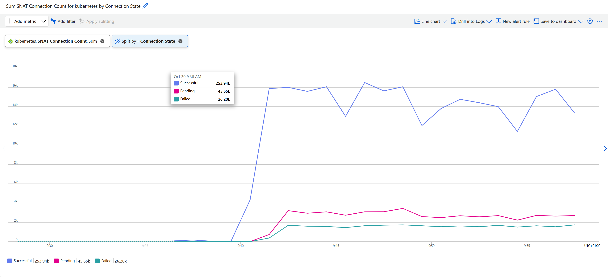

## Deploy the cluster

Run the provided terraform script to create the AKS cluster.

```bash
cd infra
export ARM_SUBSCRIPTION_ID=<your-subscription-id>
terraform init
terraform apply
```

## Deploy the application

```bash
RESOURCE_GROUP=$(terraform output -raw resource_group_name)
CLUSTER_NAME=$(terraform output -raw cluster_name)
az aks get-credentials --resource-group $RESOURCE_GROUP --name $CLUSTER_NAME
kubectl apply -f ../k8s/snat-glitch-deployment.yaml
```

## Check the cluster

After a while if you check the cluster load balancer you should see that there are SNAT issues.



## Fix the code

Modify the deployment to set the `FIXED` environment variable to `1` and redeploy the application.

```bash
kubectl apply -f snat-glitch-deployment.yaml
```

## Deploy the SRE Agent

Deploy the Azure SRE Agent: http://aka.ms/sreagent-portal